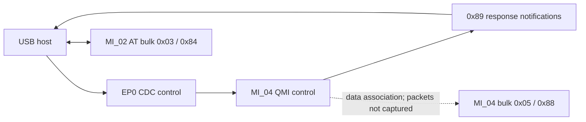
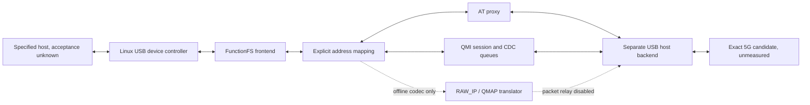

# Architecture

**SOURCE_SUPPORTED:** the software architecture below is implemented in bounded components. **UNKNOWN:** physical operation and host requirements. The laboratory coordinator is intentionally narrower than a complete dongle clone.

## Original measured device

**CONFIRMED_TARGET_DEVICE:** the control/AT paths and endpoint addresses are measured. **UNKNOWN:** the physical data framing on the bulk pair. Diagram arrows do not represent an active data session.

## Proposed bridge

**SOURCE_SUPPORTED:** the code maintains three independent numbering domains: host-visible interface/endpoint identity, FunctionFS local identity and assigned physical endpoint, and backend modem identity. Equal numbers in one example are not a general equivalence. Backend selection is explicit; there is no automatic composition change or endpoint search.

## Ownership and failure behavior

**SOURCE_SUPPORTED:** one event-loop owner coordinates interrupts and EP0. An interrupt submission must succeed before a control output that may generate a notification. Each accepted response notification permits one encapsulated GET. Host delivery is committed only after a successful frontend write. Queues, frame sizes, pending operations, client allocations and deadlines are bounded.

**SOURCE_SUPPORTED:** QMI allocation/release replies commit state only when matched. Cleanup plans bind to ownership and generation; stale plans cannot release a new owner. The stopped frontend's already-parsed undelivered responses are distinguished from local release replies. Audit-log failure during cleanup is reported without skipping teardown. Partial-open cancellation uncertainty is retained and is not hidden by a second automatic cancellation.

**SOURCE_SUPPORTED:** cleanup releases known owned CIDs, cancels/drains its interrupt, clears attempted DTR state, closes backend ownership, then unbinds and removes only its frontend resources. Failure can leave explicit retained obligations. Local bookkeeping is not proof that a modem client was physically released.

## Deliberate gaps

**UNKNOWN:** exact host behavior on MI_00/01/03. Their protocol emulation is absent. **SOURCE_SUPPORTED:** active bulk data forwarding and WDS Start/Stop are blocked in the laboratory policy. The data-plane module operates on complete packets/aggregates; USB stream reassembly and live packet relay are not established. The prototype is therefore not a full behavioral clone.

## Native RC520 scope

The [RC520 native reference](docs/native/README.md) now documents the original stock USB-to-Android path. The experimental bridge is separate; observing native operation does not validate a candidate or prove the bridge necessary.
