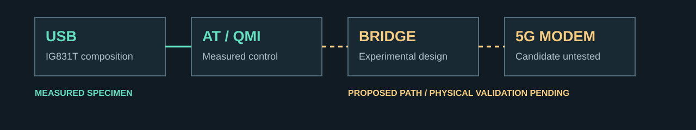
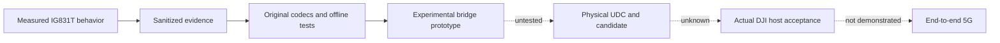

# OpenIG831T


**RESEARCH PREVIEW · EXPERIMENTAL · END-TO-END 5G REPLACEMENT NOT YET DEMONSTRATED**

OpenIG831T is an independent interoperability research project for the DJI Cellular Dongle 2 (IG831T). It documents measured USB, AT and QMI behavior, the reported Fibocom NL668T-GL modem identity, and an experimental Linux FunctionFS bridge architecture.

**CONFIRMED_TARGET_DEVICE:** USB composition, MI_02 AT, MI_04 QMI, QMI initialization/service discovery, and a WDA `RAW_IP` report. **UNKNOWN:** candidate 5G compatibility, physical gadget operation, DJI host acceptance, and whether any bridge is necessary.

[](.github/workflows/ci.yml)
[](.github/workflows/documentation.yml)
[](THIRD_PARTY_NOTICES.md)
[](STATUS.md)

The badges identify workflows and project status; they do not assert that remote CI or hardware testing has passed.

## 1. Project overview

**SOURCE_SUPPORTED:** the repository contains original protocol code, offline tests, experimental open-source kernel patches, and independently written evidence summaries. It is a research prototype, not a supported replacement product. [Documentation index](docs/index.md).

## 2. Current status

| Area | Evidence level | Status |
| --- | --- | --- |
| Internal modem identity | CONFIRMED_TARGET_DEVICE | Fibocom NL668T-GL reported |
| MI_02 AT transport | CONFIRMED_TARGET_DEVICE | Confirmed |
| MI_04 QMI control | CONFIRMED_TARGET_DEVICE | Confirmed |
| WDA RAW_IP | CONFIRMED_TARGET_DEVICE | Reported configuration |
| Physical IP frame format | UNKNOWN | Not observed |
| Candidate 5G modem | UNKNOWN | Not measured |
| Physical UDC gadget | UNKNOWN | Not tested |
| DJI host acceptance | UNKNOWN | Not demonstrated |
| End-to-end 5G | UNKNOWN | Not demonstrated |

[Machine-readable status](RESEARCH_STATUS.json) keeps `final_verdict: null`. No candidate is a confirmed drop-in replacement.

## 3. Confirmed findings

**CONFIRMED_TARGET_DEVICE:** one IG831T specimen exposed VID/PID `2ca3:4009`, five interfaces and 14 non-control endpoints. AT reported `NL668T-GL`; QMI DMS reported `NL668T-GL-00-00`, firmware `19906.5090.00.02.00.23`, hardware `V1.0.0`. A successful CTL query returned 29 service/version entries. [Sanitized summaries](evidence/README.md).

## 4. Unverified areas

**UNKNOWN:** exact replacement SKU/firmware, physical 9-IN/5-OUT endpoint allocation, FunctionFS gadget operation, actual OLD/NEW/MULTI host path, identity/authorization requirements, physical packet framing, and end-to-end 5G. Direct replacement and bridge necessity are both unestablished. [Limitations](docs/limitations.md).

## 5. Architecture

**SOURCE_SUPPORTED** components and **UNKNOWN** physical outcomes are deliberately separate:





[Architecture and safety boundaries](ARCHITECTURE.md).

## 6. IG831T USB interface table

Endpoint addresses are **CONFIRMED_TARGET_DEVICE**. Role uncertainty is retained.

| Interface | Class/subclass/protocol | Interrupt IN | Bulk IN | Bulk OUT | Role |
| --- | --- | --- | --- | --- | --- |
| MI_00 | ff/ff/ff | — | 0x81 | 0x01 | UNKNOWN |
| MI_01 | ff/00/00 | 0x83 | 0x82 | 0x02 | UNKNOWN |
| MI_02 | ff/00/00 | 0x85 | 0x84 | 0x03 | Confirmed AT |
| MI_03 | ff/00/00 | 0x87 | 0x86 | 0x04 | UNKNOWN |
| MI_04 | ff/ff/ff | 0x89 | 0x88 | 0x05 | Confirmed QMI control; packet format unobserved |

**CONFIRMED_TARGET_DEVICE:** 9 IN + 5 OUT excludes EP0. [Descriptor and control details](docs/usb-interface-map.md).

## 7. AT and QMI summary

**CONFIRMED_TARGET_DEVICE:** bounded read-only AT identity queries worked on MI_02. MI_04 used CDC encapsulated SEND/GET over EP0 with interrupt notifications; DTR-associated initialization produced CTL Sync and later a successful Get Version Info response. This sequence is not established as a universal prerequisite for other firmware. [AT](docs/at-transport.md) · [QMI initialization](docs/qmi-initialization.md) · [29 services](docs/qmi-service-map.md).

## 8. RAW_IP and data-plane status

**CONFIRMED_TARGET_DEVICE:** inputless WDA Get Data Format reported RAW_IP and disabled uplink/downlink aggregation. **STRONG_INFERENCE:** non-QMAP raw IP for that reported channel. **UNKNOWN:** actual bulk frame format. No active data session was created by the prototype; a historical WDS DISCONNECTED result covered only the queried client/default port. [Data plane](docs/raw-ip-data-plane.md).

## 9. DJI host OLD/NEW/MULTI summary

**SOURCE_SUPPORTED:** bounded static analysis of a specific SDK build identified three co-registered observers and distinct formats. The type-set predicate `{6,7,10}` belongs to MULTI, not NEW. **UNKNOWN:** active runtime path or actual host acceptance. No vendor binaries or full disassembly are included. [Host analysis](docs/dji-host-analysis.md) · [Corrected path table](docs/old-new-multi-paths.md).

## 10. Experimental bridge architecture

**SOURCE_SUPPORTED:** the prototype separates host-visible addresses, FunctionFS local/physical addresses, and backend modem addresses. It implements bounded AT/QMI handling and offline RAW_IP/QMAP translation. MI_00/01/03 behavior and active packet forwarding are deliberately incomplete. **UNKNOWN:** whether these adaptations are needed by a real host. [FunctionFS bridge](docs/functionfs-bridge.md).

## 11. Repository layout

- `src/igbridge/`: original user-space implementation.
- `tests/`, `scripts/`, `tools/`: offline validation and explicit laboratory entry points.
- `docs/`: original English research notes and diagrams.
- `evidence/sanitized/`: non-identifying summaries; no raw private captures.
- `patches/linux-functionfs/`: separately licensed experimental patches.
- `releases/`: research-preview release notes.

[Publication inventory](PUBLICATION_INVENTORY.md) and [third-party notices](THIRD_PARTY_NOTICES.md) define the actual included scope.

## 12. Quick start for offline tests

**SOURCE_SUPPORTED:** runtime code uses Python 3.10+ and the standard library. Run from the repository root:

```sh
make setup
. .venv/bin/activate
make lint
make test
make test-sanitizers
make audit
make docs
make bundle
```

Direct offline entry points:

```sh
PYTHONPATH=src python3 -m unittest discover -s tests -v
PYTHONPATH=src python3 -m igbridge dry-run
PYTHONPATH=src python3 -m igbridge.lab_daemon
PYTHONPATH=src python3 -m igbridge.candidate_inventory
```

Activate `.venv` in every new shell before the Make targets so they use the intended interpreter and development tools. `make setup` is a one-time environment setup step, not part of each test replay. These commands do not open a device. `make setup` may install optional development dependencies; sanitizer checks need a suitable C toolchain. Hardware entry points require separate explicit `--execute-live` or `--execute-lab` flags and validated targets. No live command is required for CI. Output directories must be fresh: `make bundle` uses `dist/source` and fails if that output already exists; use a new output name for another archive. [Direct tool equivalents](REPRODUCIBILITY.md#direct-tool-equivalents) describe the scripts.

The lint gate currently enables `E9` and the full Pyflakes `F` family. Formatting, import ordering, `B`, and `UP` adoption remain incremental.

## 13. Reproducibility

[REPRODUCIBILITY.md](REPRODUCIBILITY.md) separates public code/test replay from withheld private measurements. Use the final public validation report for test counts; pre-curation private results are not substituted for public release testing. CI does not establish physical compatibility.

## 14. Evidence levels

Every research claim is scoped using the [ten evidence levels](docs/evidence-levels.md). `SOURCE_SUPPORTED` does not mean measured hardware; `UNKNOWN` is neither failure nor impossibility. A hash identifies a withheld artifact but does not make it reproducible from this repository.

## 15. Hardware still required

**UNKNOWN:** an exact candidate SKU/firmware, suitable carrier/power/RF setup, measured UDC endpoint resources and a specific DJI host/context. **SOURCE_SUPPORTED:** AM335x and AM62x families offer relevant controller resources; no board is physically validated here. [Hardware validation](docs/hardware-validation.md) · [Candidates](docs/candidate-modems.md).

## 16. Safety boundaries

**SOURCE_SUPPORTED:** no automatic reset, firmware flashing, active data-session creation, IMEI/SIM/NV rewriting, entitlement bypass or cryptographic bypass is provided. Use only owned or explicitly authorized hardware. Logs may contain sensitive data; redact before contributing. [Security](SECURITY.md).

## 17. Legal and trademark disclaimer

This is an independent interoperability research project. It is not affiliated with, endorsed by, or sponsored by DJI, Fibocom, Quectel, or any mobile network operator. Trademarks identify referenced products. No warranty is provided. [Scope and licensing](docs/legal-and-ethical-scope.md).

## 18. Contributing

Read [CONTRIBUTING.md](CONTRIBUTING.md) and the community [support guide](SUPPORT.md). Submit exact firmware/composition evidence, reproduction steps, provenance and redaction confirmation. Do not upload proprietary packages, raw personal data or unsupported “working 5G” claims.

## 19. Citation

Use [CITATION.cff](CITATION.cff). Cite the release and exact commit you evaluated; retain the research-preview qualification. The citation deliberately uses the collective project author to preserve contributor privacy.

## 20. Roadmap

[ROADMAP.md](ROADMAP.md) uses independent gates for candidate evidence, UDC operation, host acceptance and active data. Passing an earlier gate never silently completes the next one.
