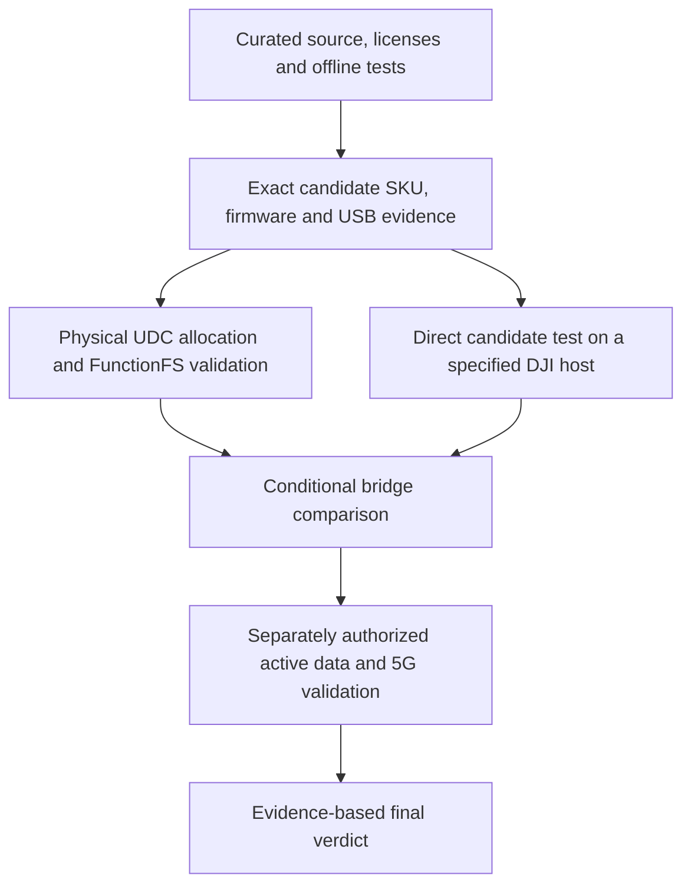

# Roadmap and independent gates

**SOURCE_SUPPORTED:** this is a validation plan, not a schedule or a claim that hardware steps have started.

| Gate | Current evidence | Completion requirement |
| --- | --- | --- |
| Public software reproducibility | SOURCE_SUPPORTED; release validation recorded separately | Clean checkout, offline suite, privacy/license scans |
| Exact candidate | UNKNOWN | Same unit: SKU, firmware, descriptors, identities, QMI services and WDA |
| Physical UDC | UNKNOWN | 14 endpoints enabled at required addresses/types; measured FIFO and dual-role topology |
| Generic host bridge | UNKNOWN | Physical descriptor/control validation and safe cleanup |
| DJI host acceptance | UNKNOWN | Exact product/firmware/app context, outcome evidence and controls |
| Active 5G data | UNKNOWN | Explicit authorization, legal radio setup, measured traffic and cleanup |
| Direct versus bridge verdict | UNKNOWN | Evidence distinguishing native compatibility from necessary adaptation |

Do not select a bridge merely because source code exists. A direct candidate test may show no bridge is needed. Conversely, a successful generic QMI session does not establish DJI compatibility. Missing responses, unsupported commands or unregistered radio state do not alone establish hardware impossibility.

Useful contributions close one bounded gap with primary sources or sanitized measurements. Repeating already exhausted model-name searches or introducing unmeasured identity rewriting does not advance these gates.

## Native RC520 scope

The [native RC520 golden reference](docs/native/README.md) closes the original stock kernel/RIL/network context and measures AT/QMI startup. Candidate hardware, native USB wire timing, application cache/control and entitlement remain independent gates.
