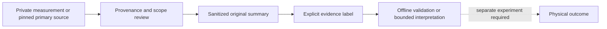

# Evidence levels

A label describes the support for a claim, not the importance of the claim. Scope must travel with the label: specimen, build, firmware, interface and observation method where known.

| Label | Meaning |
| --- | --- |
| CONFIRMED_TARGET_DEVICE | Directly measured on the original target specimen within the recorded procedure |
| CONFIRMED_TARGET_HOST | Directly observed behavior on an identified target host/runtime context |
| MEASURED_CANDIDATE_HARDWARE | Direct measurement of an identified replacement candidate and firmware |
| FAMILY_LEVEL_SOURCE_EVIDENCE | Primary documentation or driver behavior for a family or a different composition |
| SOURCE_SUPPORTED | A bounded conclusion supported by inspected source/static artifacts or original software tests |
| STRONG_INFERENCE | Consistent, substantial indirect evidence; the claimed outcome itself was not measured |
| WEAK_INFERENCE | A plausible interpretation with substantial unresolved alternatives |
| UNKNOWN | Evidence does not establish the answer; absence and failure are not inferred |
| CONTRADICTED | Specific evidence conflicts with the stated claim within its defined scope |
| SUPERSEDED | A prior interpretation was corrected; preserve the correction rather than silently reuse it |

**SOURCE_SUPPORTED:** the public summaries preserve this distinction:

Examples: a WDA RAW_IP response is **CONFIRMED_TARGET_DEVICE** configuration evidence; expected non-QMAP framing is **STRONG_INFERENCE**; physical IP framing remains **UNKNOWN** without packets. Linux driver support is **FAMILY_LEVEL_SOURCE_EVIDENCE**, not **MEASURED_CANDIDATE_HARDWARE**. No new **CONFIRMED_TARGET_HOST** result is claimed in this release.

A hash of withheld material is provenance metadata, not public access to that material. Synthetic tests stay synthetic even when their bytes resemble a real protocol message. A missing observation count is `null`, not zero.
