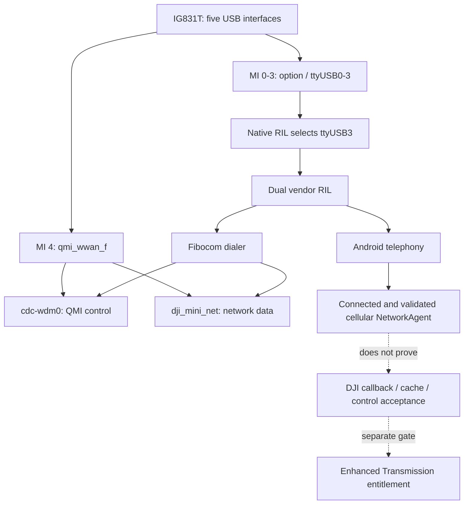

<!-- SPDX-License-Identifier: CC-BY-4.0 -->
# RC520 + IG831T native golden reference

**CONFIRMED_NATIVE_HOST:** the original DJI Cellular Dongle 2 provides native cellular networking on the examined DJI RC Pro 2. **UNKNOWN:** real 5G replacement, candidate compatibility, physical native USB packet framing, application cache/control acceptance and Enhanced Transmission entitlement.

This publication covers only the new controller and its original dongle. It contains detailed, independently written technical findings and sanitized measurement tables. No controller comparison, personal identifiers, private raw logs, vendor binaries, disassembly dumps or complete vendor manuals are included.

## Exact non-identifying context

| Component | Recorded value |
| --- | --- |
| Controller | DJI RC Pro 2 / RC520 |
| Controller firmware | 01.00.07.00 |
| Android build | V55.31.01.39; Android 11 / API 30 |
| Reported SoC / board | Qualcomm QCS5430 / lahaina; metadata, not independent silicon identification |
| Kernel | 5.4.210 |
| DJI Fly | dji.go.v5 1.21.2; versionCode 3114825 |
| Additional installed DJI package | dji.go.v9 1.19.4; versionCode 3113157; installed does not imply active |
| Original dongle | DJI Cellular Dongle 2 / IG831T; USB 2ca3:4009 |
| Native modem identity context | Fibocom NL668T-GL from the AT path; firmware 19906.5090.00.02.00.23. This boot did not query the full DMS model. |

Controller firmware and Android build are separate version namespaces. These findings do not apply automatically to another build, app or candidate firmware.

## Main discoveries

1. MI_00–03 bind to `option`, producing `ttyUSB0`–`ttyUSB3`. MI_04 binds to `qmi_wwan_f`, producing `cdc-wdm0` and `dji_mini_net`.
2. The native RIL selects **MI_03 / ttyUSB3**. Its port-selection log and subsequent AT exchanges independently support the static role table.
3. One authorized reboot exposed **180 AT request/terminal-response pairs** and **46 QMI frames / 22 matched transactions**. Independent decoders agreed. A finite early-boot log is not a continuous record of the entire collection window.
4. The native WDA request asks for **Ethernet**, but a successful response reports **RAW_IP**. The consumer accepts that result and startup proceeds. Uplink and downlink aggregation are disabled.
5. WDS Start selects **IPv4 and stored profile 1**, without an explicit APN TLV. A preceding profile read supplies context; this does not mean no APN is used.
6. Android creates a connected, validated LTE network. This confirms native network integration, not DJI application authorization or Enhanced Transmission.
7. The exact app build's normalized field is **generation**. Identity-verification support is a capability, not proof of successful authentication. Callback, parser, publication, cache and final-control runtime levels remain distinct UNKNOWNs.
8. A native RIL prefix rule accepts `2c7c:0xxx` with AT2/NET4. The documented RM520N composition fits that source-level rule, making it a useful first lab candidate. Kernel binding and end-to-end acceptance remain unmeasured.

## Read the complete findings

| Report | Contents | Structured companion |
| --- | --- | --- |
| [Platform, USB, services and Android network](platform-usb-network.md) | Descriptors, endpoint map, kernel/node relationships, process/init/property/permission model, passive network and trace evidence | [Platform evidence](../../evidence/sanitized/native-platform-usb-network.json) |
| [Native AT and QMI startup](at-qmi-startup.md) | AT catalog, QMI timeline and versions, WDA negotiation, WDS profile/session lifecycle, parser tolerance and limitations | [Protocol evidence](../../evidence/sanitized/native-at-qmi-startup.json) |
| [DJI application and identity contract](dji-application-contract.md) | Route limits, numeric callbacks, parsing/publication/cache gates, generation, identity and entitlement matrix | [Application evidence](../../evidence/sanitized/native-dji-application-contract.json) |
| [5G compatibility contract](compatibility-contract.md) | Functional requirements, direct-versus-bridge decision, candidate priority and remaining tests | [Research status](../../RESEARCH_STATUS.json) |

## Measured architecture

The intermediate edges carry different kinds of evidence. Binder process-flow metadata does not disclose transaction semantics; an accessible init declaration does not prove a process successfully loaded every library. Each detailed report preserves those boundaries.

## Observation and publication method

The evidence combines cached sysfs/proc metadata, package and service metadata, passive framework/network snapshots, a controlled reboot log, bounded existing kernel tracepoints, and static analysis of privately retained exact-build artifacts. The observer did not inject custom AT/QMI, claim USB interfaces, generate network probes, patch code or bypass protected access. Stock services performed their normal initialization and data call after the authorized reboot.

Two independent QMI decoders, descriptor byte-walk checks, independent instruction decoding, policy checks and trace framing checks covered the critical claims. Raw captures cannot be reconstructed from these summaries, and public software tests do not reproduce physical hardware experiments.

Serials and their hashes, IMEI/IMSI/ICCID, subscriber/operator details, IP/DNS addresses, APN/credentials, account/token/GPS data, host filesystem paths and exact personal event times are omitted. Protocol constants, generic software/model versions, command shapes and non-identifying aggregate counts are retained. Attribution is to OpenIG831T contributors under CC BY 4.0.
