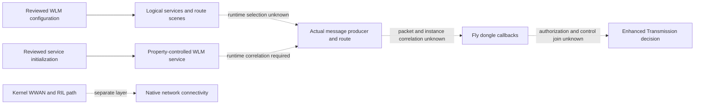
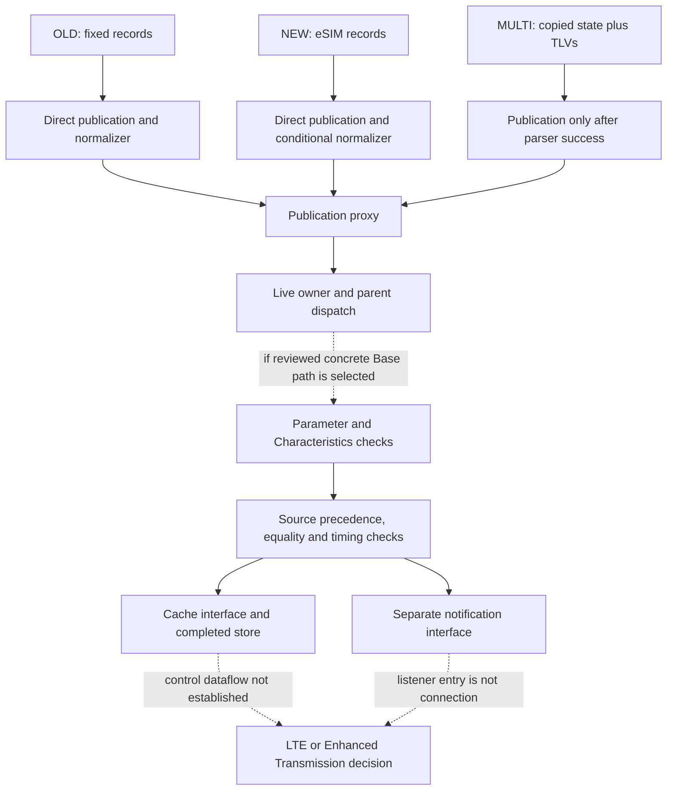

<!-- SPDX-License-Identifier: CC-BY-4.0 -->

# RC520 DJI application contract

**SOURCE_SUPPORTED:** bounded analysis of the DJI Fly 1.21.2 package identified three dongle-message families, their parsing and publication paths, and a conditional path into shared cache infrastructure. **UNKNOWN:** which family ran on the observed RC520, which values reached a completed cache write, and how those values affected an LTE or Enhanced Transmission decision.

This document concerns **DJI RC Pro 2 / RC520 with the original IG831T**. It is an application-layer contract, not a claim that a replacement modem works. Native modem Internet connectivity and DJI application authorization are separate outcomes. The machine-readable companion is [native-dji-application-contract.json](../../evidence/sanitized/native-dji-application-contract.json).

## Build and evidence boundary

**CONFIRMED_TARGET_HOST:** the controller and installed-package metadata below were recorded on RC520. **SOURCE_SUPPORTED:** the implementation findings apply to the inspected package. A loaded-library mapping, concrete object selection, or application control outcome is not inferred from package presence.

| Context | Recorded scope |
| --- | --- |
| Controller | DJI RC Pro 2, model RC520 |
| Controller firmware | `01.00.07.00` |
| Android build | `V55.31.01.39`, Android 11 / API 30 |
| Application examined | DJI Fly `1.21.2`, package `dji.go.v5`, version code `3114825` |
| Static implementation | AArch64 native components from that application package |
| Embedded SDK semantic version | **UNKNOWN**; not inferred from the application version |
| Actual loaded native-library mapping and concrete runtime objects | **UNKNOWN** for this application-path analysis |
| Application callback-to-control runtime result | **UNKNOWN** |

**SOURCE_SUPPORTED:** DJI's [product information, English specifications](https://dl.djicdn.com/downloads/DJI_RC_Pro_2/PI/DJI_RC_Pro_2_Product_Information.pdf) identifies RC Pro 2 as RC520. Its [29 April 2026 release notes, page 1](https://dl.djicdn.com/downloads/DJI_RC_Pro_2/RN/20260429/DJI_RC_Pro_2_Release_Notes_en.pdf) list firmware `01.00.0700` and Fly `1.21.2`. The controller-reported firmware spelling above is preserved separately; the release notes do not define a minimum IG831T firmware requirement.

The implementation findings below are original technical summaries of bounded static inspection. They are not instruction traces, and the public repository does not include proprietary binaries, disassembly, raw application payloads, private source hashes, or personal values. The withheld implementation cannot be independently reconstructed from this summary. Source coverage is described explicitly; it is not a complete review of the application or its services.

## WLM configuration and initialization

**SOURCE_SUPPORTED:** the inspected WLM configuration describes product RC520, a master role, an enabled LTE service, and these logical host roles:

| Logical role | Configured identifier |
| --- | --- |
| Local router | `0x0205` |
| LTE agent | `0x0e06` |
| Local WLM | `0x0e07` |
| Peer WLM | `0x0907` |

It defines `SDR_ONLY`, `LTE_ONLY`, and `HYBRID_LTE_SDR` link-switch scenes with different service-step orderings. These are configuration choices, not observed active modes. An enable flag or an LTE scene does not establish a bearer, a valid license, or an accepted Enhanced Transmission session.

The reviewed USB-channel entries describe **`2ca3:1020`**, not the IG831T modem's **`2ca3:4009`**. For example, the link module has interface 3 and interface 0 channel entries, while the LTE-agent module has an interface 5 entry. Those entries belong to the WLM/DUML service-routing configuration. They are not a kernel WWAN binding table, and their interface or endpoint numbering must not be transferred to the modem.

The same configuration includes local socket channels named `dji_lte_v1` and `wl_lte_v1`, plus separate live-view channels. The service initialization record starts or stops `dji_wlm` according to the `dji.wlm_service` property's `1` or `0` value. These are descriptions of inspected configuration; no service-changing command is provided here.

**UNKNOWN:** the complete selected runtime route, the exact producer-to-Fly connection, and whether these particular configuration entries were used during the observation. A separately selected persistent route configuration could not be read in the available permission scope. A candidate configuration file is not proof that it was loaded. Conversely, the absence of `4009` from the reviewed WLM channel entries is not evidence that the QMI modem was rejected.

## Numeric message families

**SOURCE_SUPPORTED:** the inspected setup contains registration paths for all three families. Registration code does not prove registration completed, select a primary family, or demonstrate that any callback ran. More than one family may participate in a single application state.

| Research label | Numeric message ID | Packet name in this build | Callback and subsequent processing |
| --- | --- | --- | --- |
| OLD | `0x40180040` | `wlm_dongle_info_push` | `OnWlmDongleInfoPush`, followed by `HandleOldDongleInfoLogic` |
| NEW | `0x4018004A` | `wlm_dongle_esim_info_push` | `OnWlmEsimInfoPush`, followed by `HandleOldEsimInfoLogic` |
| MULTI | `0x40180050` | `wlm_dongle_new_push` | `OnDongleInfoNewPush`, using the device-selector and TLV parsers |

The labels are stable research notation for this table. In particular, the word **`new` in a build symbol names `0x40180050`**, whereas the table's **NEW label means `0x4018004A`**. Numeric IDs resolve this naming ambiguity. OLD is a message-family label within this build, not a claim about a different controller.

### OLD: fixed records and normalization

**SOURCE_SUPPORTED:** the reviewed fixed-record path checks that `2 + record_count * 53` does not exceed the supplied payload length. A source selector distinguishes UAV (`0`) from remote controller (`1`) state. This is a size gate found in the selected code, not a guarantee that all malformed inputs are safely rejected.

The direct callback can publish `WlmUavDongleInfo` or `WlmRcDongleInfo`. Its subsequent normalizer can also update the common `UavDongleInfo` / `RcDongleInfo` and `UavDongleNetcardInfo` / `RcDongleNetcardInfo` models. Consequently, observing a common publication key would not, by itself, identify the originating wire family.

### NEW: eSIM records and a state-dependent normalizer

**SOURCE_SUPPORTED:** this path uses a size gate of `7 + record_count * 159 <= payload_length`. The source selector is at payload byte 1 and selects the UAV or remote-controller branch. The direct publication keys are `WlmUavDongleEsimInfo` and `WlmRcDongleEsimInfo`.

The subsequent normalizer has additional state prerequisites: an existing nonempty netcard cache and a nonempty nested collection. It can then update the common netcard model. If those prerequisites are missing, normalization can be suppressed without constituting a modem-brand rejection. The existence of this eSIM parser does not establish eSIM capability or use by the observed IG831T.

### MULTI: TLVs applied to copied state

**SOURCE_SUPPORTED:** `ParseNewDongleDevice` accepts source selectors `0` and `1`. The callback copies existing BasicInfo and Netcard cache objects before calling `ParseNewDongleInfo`. A parser return value of zero is required before the reviewed common-state publication calls.

| TLV tag | Reviewed purpose |
| --- | --- |
| `1` | Dongle identifier information |
| `2` | Basic information, including type-to-generation normalization |
| `3` | Capability bits |
| `4` | Netcard information |
| `9` | Display status |

A path selected by payload byte 2 equal to zero clears collections and returns success. Thus, successful parsing need not mean that a dongle is present or that a connection is active. Because the parser starts from copied cache state, a message also need not regenerate every published field. A parser error can prevent publication; neither outcome establishes an authentication decision.

**Coverage limit:** selected header reads occur before some length checks. This analysis is not a complete memory-safety assessment, a fuzzing result, or a specification for safely replaying arbitrary vendor payloads. A callback entry must never be counted as a successful complete parse.

## Generation and identity are different fields

**SOURCE_SUPPORTED:** the current build's typed BasicInfo schema names the normalized field **`generation`**. It does not name that field `isDjiDevice`. The following classifications were traced in the respective normalizers:

| Family and field | Input type | Normalized generation |
| --- | --- | --- |
| OLD normalizer | `6` or `7` | `0` |
| OLD normalizer | `10` | `1` |
| OLD normalizer | Other values | `65535` |
| MULTI BasicInfo TLV | `10` | `1` |
| MULTI BasicInfo TLV | `13` | `2` |
| MULTI BasicInfo TLV | `15` | `3` |
| MULTI BasicInfo TLV | Other values | `65535` |

These are numeric classifications in this build, not a public crosswalk to commercial modem models. For MULTI, an unknown type proceeds into the shared parser tail; it is not, by itself, a parse rejection. That does not prove that every later consumer accepts the resulting state.

The selected BasicInfo parser checks for at least 41 bytes of its TLV value. The typed schema also contains device-side classification, upgrade flags, a version field, capabilities, and display status. Identifier field names are discussed only to explain structure; no actual identifier values are published.

| MULTI capability source | Typed destination | What the source establishes |
| --- | --- | --- |
| TLV `3`, bit `3` | `isSupportIdentityVerification` | A support/capability flag |
| TLV `3`, inverted bit `4` | `isNeedSystemSetting` | A setting-requirement flag |
| TLV `3`, bit `5` | `isSupportPackageUpgrade` | A package-upgrade capability flag |
| TLV `3`, bit `6` | `isSupportDisplayControl` | A display-control capability flag |

**UNKNOWN:** whether identity verification was required, invoked, successful, skipped, or rejected in the observed application context. `isSupportIdentityVerification` is not an authentication result. The absence of a named `isDjiDevice` field from this specific typed BasicInfo schema is not proof that no such field or equivalent check exists elsewhere. The meanings of every flag in the separate legacy state object were not established.

## Publication, cache storage, and control

**SOURCE_SUPPORTED:** a common publication proxy first needs a live weak owner and a nonnull parent. It then calls the parent's virtual update function. The reviewed BaseAbstraction implementation provides the following possible continuation; the concrete runtime parent, overrides, and injected interfaces were not identified by this static analysis.

1. **Parameter filtering:** an exclusion set and a valid/enabled Characteristics record govern whether the Base publication path proceeds.
2. **Typed update policy:** existing/new values, access type, SetEnable/PushEnable source precedence, equality, and time/difference conditions affect cache updates and notifications.
3. **Cache interface call:** the selected implementation can call a cache-writing interface. The reviewed concrete CacheLayer has a protected map update that stores the value and subsequently unlocks its mutex.
4. **Notification:** a separate interface can publish an update notification. A notification call and a completed cache store are distinct events.

Equality is a value comparison here; it is not evidence of a DJI-brand allowlist. Source precedence or equality can suppress a repeated update without rejecting the modem. Calling `UpdateParamValue` is not proof of a cache commit, and entering `SetCacheValue` is not proof that its final store completed.

**SOURCE_SUPPORTED:** the inspected `SetWlmLinkMode` body checks for a nonnull value and the expected input type. A failed check returns an error; accepted typed input reaches a sending proxy. This particular body did not establish a generation, brand, region, or license comparison. **UNKNOWN:** the decisions of its callers, UI, other components, or remote services. The bounded review did not connect a published dongle field to a deciding branch in that control path, and no control command was executed for this analysis.

## Identity and authorization matrix

| Question | Evidence level | Bounded conclusion |
| --- | --- | --- |
| Is dongle type converted to generation? | **SOURCE_SUPPORTED** | Yes, using the family-specific numeric mappings above |
| Does an unknown MULTI type itself fail the selected BasicInfo parser? | **SOURCE_SUPPORTED** | No; the reviewed path continues with generation `65535` |
| Is generation a proved DJI-authenticity boolean? | **SOURCE_SUPPORTED** | No; the typed field is generation |
| Is verification support transported into typed state? | **SOURCE_SUPPORTED** | Yes; capability bit, not verification outcome |
| Are identifier/version data fields present? | **SOURCE_SUPPORTED** | Yes; storage or publication does not prove an allowlist or cryptographic comparison |
| Is `isDjiDevice` the deciding field for this application? | **UNKNOWN** | No such source-to-control decision was established in the reviewed scope |
| Does Fly compare USB identity, AT identity, or firmware against an allowlist? | **UNKNOWN** | No deciding compare established here; other layers remain outside this negative conclusion |
| Do publication filters exist? | **SOURCE_SUPPORTED** | Yes, conditionally in the reviewed concrete Base path; they regulate state updates |
| Were upper-layer `canEnable`, aircraft/product, or region decisions identified? | **UNKNOWN** | Exact deciding branches and runtime outcomes remain unresolved |
| Were account entitlement, server activation, or cryptographic authenticity decisions observed? | **UNKNOWN** | Capability fields and configuration flags cannot answer these questions |
| Does native Internet prove Enhanced Transmission authorization? | **UNKNOWN** for authorization | Network connectivity supplies no application-authorization verdict |

“Required” is only meaningful with an identified path and predicate. A valid typed argument is required by the reviewed setter. A valid Characteristics entry is required by the reviewed Base publication path. No broader identity or entitlement requirement is classified as **NOT_REQUIRED** merely because this bounded inspection did not locate it.

## Official product and service conditions

The following **SOURCE_SUPPORTED** policy facts refer to DJI documents archived on **12 October 2026**, not to a measured account state:

- DJI's [China cellular-dongle product page, compatible products](https://store.dji.com/cn/product/dji-cellular-2?set_region=CN) lists RC Pro 2. That page does not establish an exact IG831T firmware contract.
- The [international Dongle 2 page, overview and tips](https://store.dji.com/si/product/dji-cellular-2?from=site-nav&set_region=SI) gives RC Pro 2 regional restrictions and distinguishes service regions and renewal conditions. Its service-expiry guidance separates Enhanced Transmission from other dongle connectivity functions. These restrictions are not a measured kernel or RIL rejection.
- The [Chinese RC Pro 2 manual, section 4.4, page 17](https://dl.djicdn.com/downloads/DJI_RC_Pro_2/UM/20250515/DJI_RC_Pro_2_User_Manual_v1.0_zh-cn.pdf) describes controller Internet access through an installed module or a phone hotspot. Controller-side dongle presence is therefore not established as a universal requirement for every documented Enhanced Transmission arrangement.

**UNKNOWN:** the observed setup's service region, account eligibility, aircraft compatibility, active entitlement, or authentication result. A storefront locale is not evidence of the operator's location. No license, identity, or cryptographic bypass follows from the source findings.

## Runtime levels: all unresolved

The level numbers below are defined for this RC520 investigation. Static registration and static call-graph edges do not complete any runtime level.

| Level | Event needed | Status | Observed hit count |
| --- | --- | --- | --- |
| L1 | Callback hit for the numeric family | **UNKNOWN** | `null` |
| L2 | Parser success for that same input/context | **UNKNOWN** | `null` |
| L3 | Publication of the resulting state | **UNKNOWN** | `null` |
| L4 | Completed cache store for that state | **UNKNOWN** | `null` |
| L5 | Resulting LTE/Enhanced Transmission control decision | **UNKNOWN** | `null` |

These statuses apply separately to OLD, NEW, and MULTI. `null` means not established; it must not be replaced with zero. The available logs were not an instruction trace for these events. Missing callback names do not establish absence, and the duration of a collector is not the duration of complete callback coverage.

## Open questions and evidence that could close them

| Unresolved point | Minimum useful additional evidence |
| --- | --- |
| Selected producer and route | Authorized metadata that identifies the actually selected configuration, service endpoints, and message route |
| Active family or combination | Numeric message IDs and callback outcomes correlated to the same instance and observation window |
| Valid input and parser acceptance | A distinct parser outcome; callback entry alone is insufficient |
| Which source last wrote common state | Family lineage plus publication key and completed store on the same concrete cache instance |
| Concrete parent and cache implementation | Matched loaded build and virtual-dispatch context; static candidate implementations are insufficient |
| Identity-dependent control | A specific deciding comparison and its resulting branch, with a verified connection to the parsed state |
| Product, region, and entitlement outcome | Authorized coarse decision/status metadata from the relevant application/service context |

A future observation design should verify the loaded build and ASLR mapping privately, use ephemeral instance/route correlation tokens, and record event outcomes independently. Temporal proximity alone is a weaker relationship than an exact same-instance link. Payload bodies, serials, subscriber identifiers, account information, certificates, and tokens are unnecessary for this publication and must not be posted.

Opening an available cellular/Enhanced Transmission **status page without changing settings** could provide context, but it may only read cached state and may emit no useful callback metadata. Its exact navigation path and sufficiency are not established here. This document does not provide a tracer or authorize a new device action.

## Coverage and replacement implications

**SOURCE_SUPPORTED:** the bounded inspection covered the three numeric registration/invocation paths, their selected parsers and normalizers, typed BasicInfo field naming, the common publication/cache candidate path, and the selected link-mode setter. Symbol/relocation relationships and critical instruction encodings were cross-checked; this was not an independent verification of every instruction, every parser, or all application consumers.

**UNKNOWN:** global identity policy, complete caller coverage, active abstraction, concrete runtime dispatch, parser outcomes on live inputs, cache precedence during the observation, and the final application control/authorization path. No statement here applies to all DJI products or every Fly release.

For replacement research, matching USB, AT, and QMI behavior cannot by itself settle this application layer. Conversely, unresolved application checks do not prove that a bridge, identity rewrite, or exact descriptor clone is required. No 5G replacement or Enhanced Transmission compatibility verdict is established by this contract.
