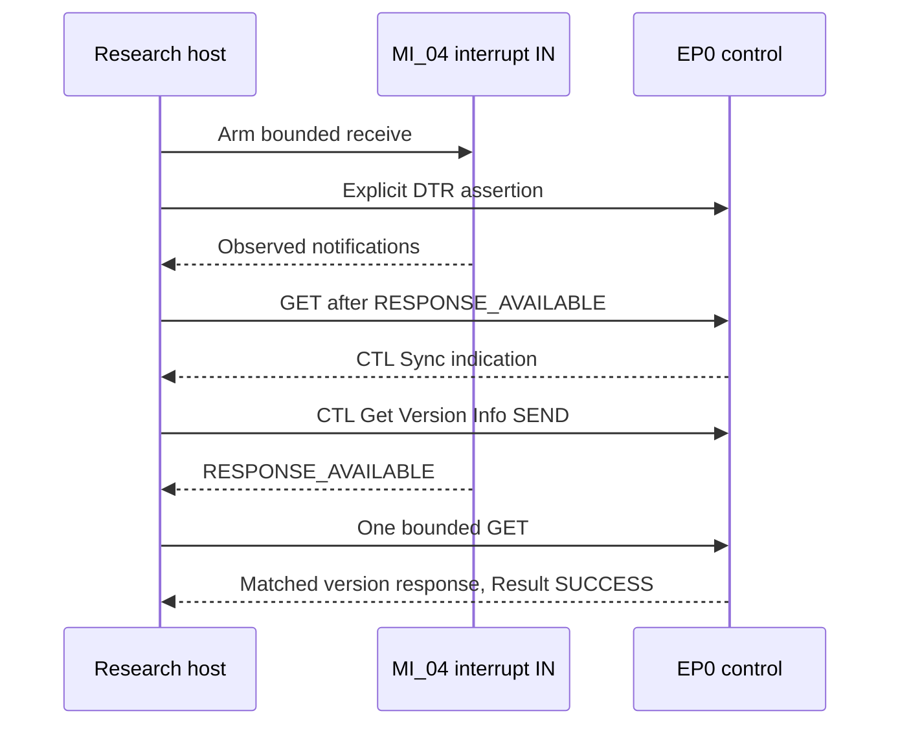

# QMI initialization and lifecycle

**CONFIRMED_TARGET_DEVICE:** MI_04 QMI control was established through valid device-to-host QMUX/QMI messages, not inferred from descriptors alone. The original sequence included DTR-associated `NETWORK_CONNECTION` and `RESPONSE_AVAILABLE` notifications, a CTL Sync indication, and a later successful CTL Get Version Info response with 29 service entries.

**CONFIRMED_TARGET_DEVICE:** Sync is CTL message `0x0027`, an indication, and is distinct from response `0x0021`. A received Sync cannot be relabeled as the answer to an older version query. The successful version exchange used its own transaction correlation. **UNKNOWN:** whether another candidate/firmware needs the same DTR/Sync ordering.

**SOURCE_SUPPORTED:** CTL uses an 8-bit transaction identifier; ordinary service messages use 16 bits. QMUX framing length, direction, service/client, message kind, transaction and TLV bounds are checked before interpretation. Result TLV success is separate from transport completion. Unknown TLVs are preserved rather than guessed.

**CONFIRMED_TARGET_DEVICE:** temporary client allocation and release were exercised on the original unit. **SOURCE_SUPPORTED:** the prototype's ownership model commits a client only after a matched successful allocate; it validates releases and prevents stale cleanup plans from acting on a new owner. An unresolved allocation or cancellation remains an explicit cleanup obligation. A table clear is not proof of device-side release.

**UNKNOWN:** a carrier-down notification's underlying radio cause. DTR, SIM readiness, network registration and a WDS packet session are different state variables. A notification value of zero does not by itself identify ECM/RNDIS mode or prove the modem has no service capability.

[Service list](qmi-service-map.md) · [CDC and libqmi references](references.md)
