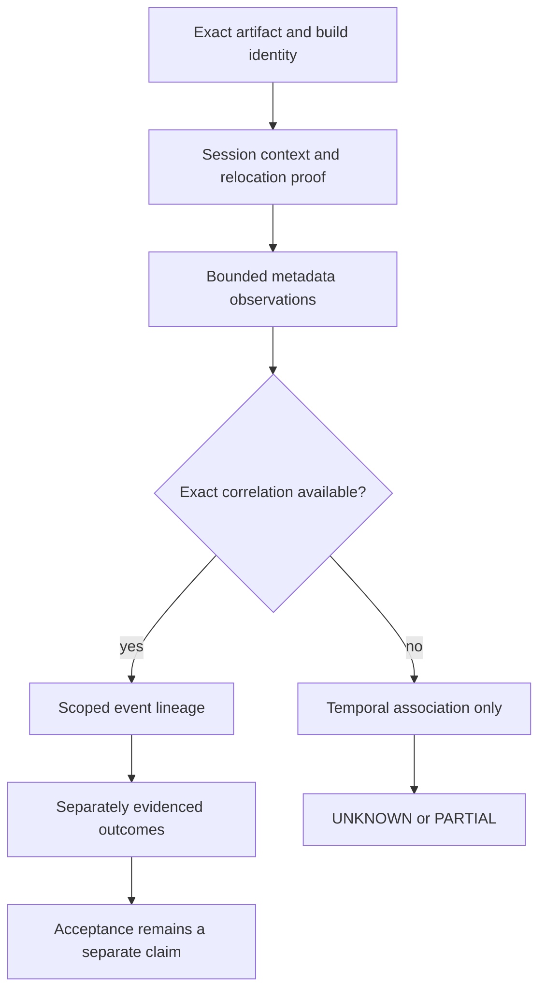

# Runtime observation plan

**SOURCE_SUPPORTED:** this is a metadata-only evidence design. **UNKNOWN:** actual target runtime context; no callback/cache/control trace is included. Existing-log collection and a synthetic event evaluator are different from a ready, validated instrumentation system.

Before any future observation, require the exact software artifact hash/build identity, runtime relocation evidence, product/firmware context, a bounded window, explicit ownership and a reviewed metadata schema. A build mismatch rejects address reuse. Raw packet bodies, registers, process memory and personal identifiers are outside this publication plan.

**SOURCE_SUPPORTED:** distinguish registration attempt from completion, callback entry from parser acceptance, publication from completed cache store, and listener entry from network connection. Entry-only observations cannot establish rejection or prove the absence of downstream work. A missing field/context is PARTIAL or UNKNOWN, not a negative event.

Use exact event lineage only when the metadata actually supplies it; temporal proximity is not transaction correlation. Multiple families may coexist. Contradictory provenance must not be resolved by silently overwriting the earlier source. Absence claims require an independently justified observation window and coverage; without those, event counts remain `null`.

**UNKNOWN:** active OLD/NEW/MULTI path and the field checks actually necessary for host acceptance. The public release does not include dynamic instrumentation, payload mutation or an authorization-bypass workflow. [Host analysis](dji-host-analysis.md).
